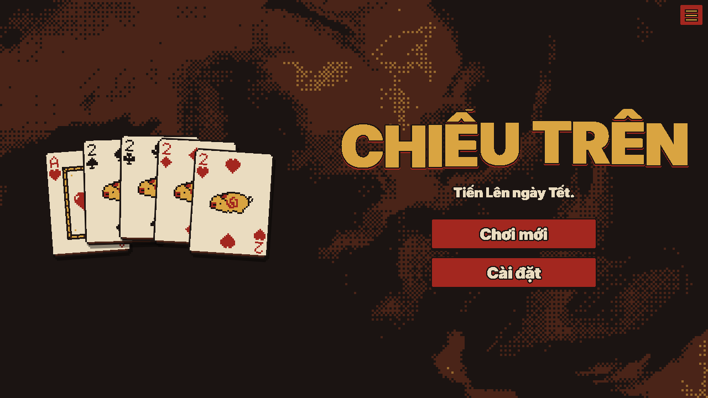
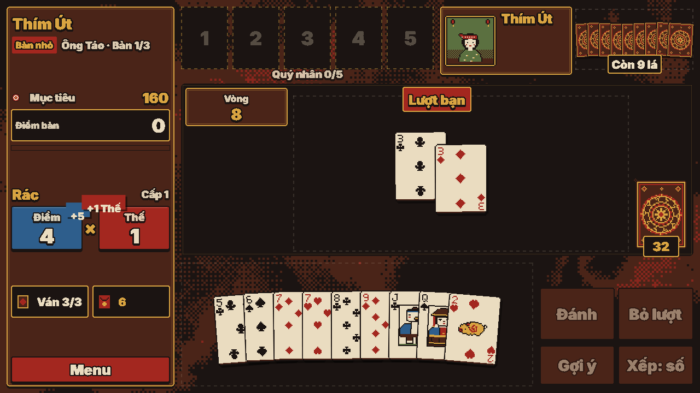
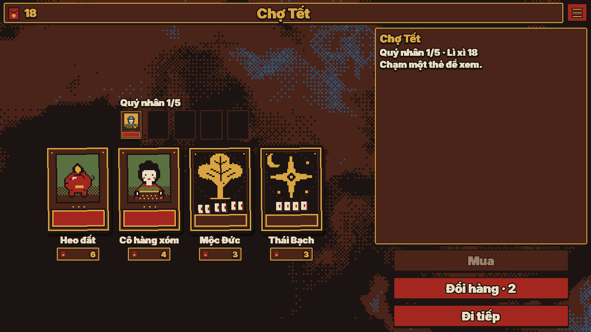

<div align="center">



# CHIẾU TRÊN
**Tiến Lên miền Nam ngày Tết, chơi kiểu roguelike.**
*Ba chặng, chín bàn, một đối thủ ngồi đối diện. Thắng ván, ăn hũ, nhân Điểm × Nhân — qua được hết thì năm nay êm.*

### [▶ CHƠI NGAY — harieedawwn.github.io/chieu-tren](https://harieedawwn.github.io/chieu-tren/)

*Không cần cài đặt. Chạy trên điện thoại, máy tính bảng và máy tính; lưu tự động, chơi tiếp bất cứ lúc nào.*

</div>

---

## Bàn chiếu trên là gì?

Mùng Một chưa tới mà nhà nào cũng đã trải chiếu. Bạn ngồi xuống đánh Tiến Lên 1 đối 1 với từng người trong họ, từ chú Bảy bạn của ba đến ông Sáu khó tính ở bàn trùm. Mỗi bàn có một mục tiêu **Tổng điểm**; đủ điểm thì qua bàn, nhận lì xì, ghé **Chợ Tết** sắm thêm Quý nhân và Sao rồi ngồi tiếp bàn sau. Hết ba ván mà chưa đủ điểm là thua.

<table>
<tr>
<td align="center"><br><sub><b>Màn chính</b><br>đón khách bằng tứ heo</sub></td>
<td align="center"><br><sub><b>Trên bàn</b><br>mỗi lá bài nhảy ra một con số</sub></td>
<td align="center"><br><sub><b>Chợ Tết</b><br>tiêu lì xì cho cả chặng sau</sub></td>
</tr>
</table>

## Tính năng

- Tiến Lên miền Nam 1 đối 1 với máy: 3 chặng, 9 bàn, mỗi chặng một bàn trùm có Luật nhà.
- Điểm × Nhân kiểu Balatro, gom vào Hũ; chặt nhân đôi hũ.
- 28 Quý nhân (thường, hiếm, quý) cộng 5 Báu vật, 6 Sao, 6 Quẻ dùng một lần, Bao lì xì mở ra chọn 1 trong 3.
- 6 Luật nhà, rút ngẫu nhiên mỗi chuyến, không trùng.
- Chợ Tết sau mỗi bàn: mua, bán, đổi hàng, mở bao.
- Chơi tiếp: vô tận sau Mùng Một; Sổ tay ghi lại mọi thứ đã gặp.
- Hướng dẫn của Ông Táo, lưu tự động, chạy trên điện thoại và máy tính, không cần cài đặt.

## Chế độ chơi

| Chế độ | Mô tả |
|---|---|
| **Chơi thường** | Ba chặng, chín bàn; bàn trùm chặng 3 là **Sòng Giao thừa**: bạn đấu boss và hai người họ hàng (4 người). |
| **Thử thách ngày** | Cùng một ván cho mọi người (Chiếu 2, không Khởi đầu, không tiện ích); mỗi ngày một lượt, có nút Sao chép kết quả. |
| **Vô tận** | Mở sau lần thắng đầu: vào thẳng chặng 4 trở đi. |
| **Sòng bốn** | Mọi bàn là 4 người. Mở sau khi thắng một bàn bất kỳ. |

## Tiếng tăm, Cây mai, Khởi đầu, Chiếu

- Mỗi chuyến cho **Tiếng tăm** (kinh nghiệm: bàn vượt qua, chặt, hũ lớn, thắng). Mỗi cấp lên được 1 **hoa mai**.
- **Cây mai** dùng hoa mai mở thêm Quý nhân, Quẻ, Báu vật vào kho, các kiểu **Khởi đầu** và tiện ích (thêm Lượt đổi, Lãi dày, Đổi hàng rẻ, Ô giữ đồ).
- **Khởi đầu**: Mặc định; Con nhà nghèo (0 lì xì, Trần Lãi cao hơn); Con cưng (một Quý nhân hiếm, mục tiêu +15%); Dân chơi (có Dân chơi Chợ Lớn, không có Lượt đổi); Học trò (mọi kiểu bài cấp cao, ít ô Quý nhân); Có lộc (2 Quẻ ngẫu nhiên).
- **Chiếu** 1-6: thắng Chiếu nào thì mở Chiếu kế. Chiếu 2 mục tiêu +15%, 3 đối thủ luôn ở cấp cao nhất, 4 Trần Lãi −2, 5 bàn trùm cuối có hai luật nhà, 6 bớt một Lượt đổi, bàn lớn cũng có luật nhà và mục tiêu thêm 30%.

## Bài xấu, Lượt đổi, Sức bài, Khí thế

- **Sức bài** (sao trên bài tay) cho biết bài chia đẹp hay xấu; tay xấu nhất (1 sao) là **Bài xấu**.
- **Lượt đổi**: khi đang dẫn một hũ mới, đổi 1-3 lá lấy lá chưa chia; mỗi bàn có số lượt giới hạn (nút **Đổi**, phím `D`).
- **Khí thế** (3 chấm): đánh tự tin và liền mạch thì lên, càng cao hiệu ứng và Nhân càng mạnh; bị chặn thì tụt.
- **Báu vật**: 5 Quý nhân đặc biệt (viền lửa tím), chỉ ra từ chặng sau: Thần Tài, Ông Địa, Táo Quân, Vua bài, Cá chép.

## Hướng dẫn

Lần đầu bấm **Chơi mới**, Ông Táo hiện ra dạy một ván có sẵn bài: chọn đôi, xem Điểm × Nhân, đè hay buông, chặt heo, ăn hũ. Bỏ qua được bất cứ lúc nào; xem lại trong **Cài đặt → Hướng dẫn**.

## Ăn hũ

- Một **ván** chia mỗi bên 10 lá. Hũ kéo dài đến khi có người bỏ lượt; người đánh cuối cùng **ăn hũ**.
- Mỗi lần đánh, điểm của bài được cộng vào **hũ**. Bỏ lượt là nhường cả hũ cho đối thủ — nên đôi khi nhịn mới là ăn.
- **Chặt** (tứ quý, đôi thông đè heo…) không chỉ hạ bài: nó **nhân đôi cả hũ** (`hũ = (hũ + điểm chặt) × 2`) và có thể bị chặt chồng.
- Ăn hũ thì cả hũ vào **Tổng điểm** của bạn. Thắng ván còn có thưởng: mỗi lá đối thủ còn cầm, ×2 cho mỗi con **heo thối**, ×2 nếu đối thủ **cóng** (chưa đánh lá nào), ×3 nếu **tới trắng** (chia ngay tứ quý heo).
- Thua ván mà tay còn heo thì bị trừ điểm.

## Điểm × Nhân

Mỗi bài ghi điểm kiểu Balatro: **Điểm** (chip, xanh lam) nhân **Nhân** (mult, đỏ son).

| Bước | Điều gì xảy ra |
|---|---|
| 1. Gốc | Mỗi kiểu bài có Điểm và Nhân riêng (rác, đôi, sám, sảnh, đôi thông, tứ quý). Sảnh và đôi thông dài hơn thì cộng thêm Nhân. |
| 2. Từng lá | Mỗi lá cộng Điểm theo mặt bài, từ 3 đến 15 cho heo. |
| 3. Sao | Sao nâng cấp một kiểu bài, cộng cả Điểm lẫn Nhân. |
| 4. Quý nhân | Lần lượt từng ô, từ trái sang phải. |
| 5. Chặt | Nhân hũ. |

Tổng của lượt đánh = `⌊Điểm × Nhân⌋`, và nó đập vào hũ cùng tiếng trống.

## Quý nhân, Quẻ, Sao, Luật nhà

**Quý nhân** — tối đa 5 ô, giữ suốt cả chuyến đi, bán lại được nửa giá. Có 20 người, chia ba độ hiếm: thường, hiếm (men lam), quý (vàng kim). Cửa hàng ra Quý nhân theo tỉ lệ 70 / 25 / 5 và không bao giờ bán người bạn đã có.

| Quý nhân | Tác dụng |
|---|---|
| Thầy bói | Đầu ván, lật 3 lá của đối thủ. |
| Cô hàng xóm | Luôn thấy đối thủ còn mấy heo. |
| Chú xe ôm | Sảnh: +10 Điểm mỗi lá. |
| Thằng bạn thân | Mỗi lần bỏ lượt: +5 Nhân cho lần đánh kế. |
| Heo đất | Thắng hũ bằng heo: +2 Nhân vĩnh viễn. Heo bị chặt thì vỡ. |
| Dân chơi Chợ Lớn | Chặt: nhân hũ ×3 thay vì ×2. |
| Bà bán xôi | Rác: +6 Nhân. |
| Ông đồ | Đôi: +5 Nhân. |
| Cô giáo | Sảnh: +2 Nhân mỗi lá từ lá thứ 4. |
| Anh shipper | Đánh từ 5 lá trở lên: +30 Điểm. |
| Bà bán vé số | Mỗi lần ăn hũ: 1/4 cơ hội +2 lì xì. |
| Chú thợ may | Đôi thông: +5 Nhân. |
| Ông câu cá | Ăn hũ từ nửa Mục tiêu trở lên: +3 lì xì. |
| Mẹ chồng | Bàn trùm: nhân ×1,5 Nhân. |
| Thằng em | Rác từ 7 trở xuống: +15 Điểm. |
| Chị bán hoa | Thắng ván: +1 lì xì mỗi heo bạn đã đánh. |
| Ông kế toán | Mỗi 5 lì xì đang giữ: +1 Nhân, tối đa +5. |
| Chú ba gác | Sám: +4 Nhân. |
| Bà Mai | Đôi J, Q, K: nhân ×2 Nhân. |
| Thằng cháu | Lần đánh đầu mỗi ván: +4 Nhân. |

**Quẻ** — dùng một lần, giữ tối đa 2, mua ở Chợ Tết và dùng ngay trên bàn (chạm vào ô Quẻ bên trái bàn, bấm **Dùng**):

| Quẻ | Tác dụng |
|---|---|
| Đổi bài | Đổi tối đa 3 lá đã chọn với lá chưa chia. Chỉ dùng ở lượt bạn. |
| Thêm ván | +1 ván cho bàn này. |
| Soi bài | Xem hết bài đối thủ cho đến khi hũ được lấy. |
| Gấp đôi | Lần đánh kế của bạn: nhân ×2 Nhân. |
| Lộc | +4 lì xì. Dùng được cả trong Chợ Tết. |
| Lên sao | +1 cấp cho một kiểu bài ngẫu nhiên. |

**Bao lì xì** — bán ở Chợ Tết. Mở ra, chọn 1 trong 3 Quý nhân hoặc Quẻ ngẫu nhiên (chỉ ra loại còn chỗ trống).

**Sao** — mua ở Chợ Tết để nâng cấp một kiểu bài: Thổ Tú (rác), Thủy Diệu (đôi), Vân Hớn (sám), Thái Dương (sảnh), Mộc Đức (đôi thông), Thái Bạch (tứ quý). Mỗi cấp cộng thêm cả Điểm lẫn Nhân.

**Luật nhà** — mỗi chặng có một bàn trùm, luật rút ngẫu nhiên từ 6 luật (không trùng trong một chuyến):

- **Bà Nội** ra bài trước, luôn luôn.
- **Chú Ba** không được chặt heo.
- **Ông Sáu** có đè là phải đè, không được bỏ lượt.
- **Cô Hai** sảnh phải đồng chất.
- **Bác Chín** không được về bằng heo.
- **Dì Út** bàn này chỉ đánh 2 ván.

## Chơi tiếp: vô tận

Qua được chặng 3 (Mùng Một), bấm **Chơi tiếp: vô tận** để vào chặng 4, 5, 6… Mục tiêu mỗi chặng tăng dần, bàn trùm luôn đổi luật ngẫu nhiên, và chuyến đi chỉ kết thúc khi bạn thua.

## Sổ tay

Nút **Sổ tay** ở màn chính ghi lại mọi Quý nhân, Quẻ, Sao và Luật nhà bạn đã gặp (đang bán, đang giữ hoặc đã đối đầu). Chưa gặp thì chỉ hiện bóng tối và `???`. Chạm một thẻ để xem tên, độ hiếm và mô tả. Sổ được lưu trên máy, dùng chung cho mọi chuyến đi.

## Bảng thuật ngữ

| Gọi trong game | Ý nghĩa |
|---|---|
| **Nhân** | Số nhân của Điểm: Điểm × Nhân = tổng của lượt đánh. |
| **Hũ** | Chỗ gom điểm của các lượt đánh. Người đánh cuối cùng **ăn hũ**. |
| **Tổng điểm** | Điểm bạn đã gom được trên bàn, so với Mục tiêu. |
| **Lãi** | Lì xì thêm khi qua bàn, theo số lì xì bạn đang giữ. |
| **Sao** | Nâng cấp một kiểu bài. |
| **Lì xì** | Tiền đi Chợ Tết. |
| Heo, chặt, đè, đôi, sám, sảnh, đôi thông, tứ quý, rác, thối heo, cóng, tới trắng, bỏ lượt | Thuật ngữ Tiến Lên giữ nguyên. |

## Điều khiển

| | Máy tính | Cảm ứng |
|---|---|---|
| Chọn / bỏ chọn lá bài | Click | Chạm |
| **Đánh** | `Enter` | Nút Đánh |
| **Bỏ lượt** | `Space` | Nút Bỏ lượt |
| **Gợi ý** (lần lượt các bộ đánh được) | `H` | Nút Gợi ý |
| **Xếp** bài theo số / theo chất | `S` | Menu → Xếp bài |
| Menu, Cài đặt, đóng hộp thoại | `Esc` | Nút Menu |
| Xem mô tả Quý nhân, Quẻ | Rê chuột / click | Chạm vào ô |
| Chợ Tết: chọn thẻ, mua / bán / dùng, đi tiếp | Click, `←` `→`, `Enter`, `Space` | Chạm |

**Cài đặt:** âm thanh, tốc độ 1× / 2× / 3×, scanlines, giảm chuyển động (tự bật theo thiết lập hệ thống).

## Chạy tại máy

Không cần build: mở `index.html` bằng trình duyệt (hoặc `python3 -m http.server`).

```bash
node tests/rules.test.js   # luật Tiến Lên
node tests/rules2.test.js  # luật nhà mới, đổi bài, soi bài
node tests/qn.test.js      # Quý nhân mới
node tests/que.test.js     # Quẻ, chợ, Bao lì xì, vô tận, lưu game
node tests/run.test.js     # chuyến đi, chợ, lưu game
node tests/sim.js 300      # mô phỏng 300 chuyến (bàn trùm ngẫu nhiên, vô tận)
node tests/sim.js 300 1 6 full mac_dinh 2 bau   # [chuyến] [seed] [Chiếu] [empty|full cây] [Khởi đầu] [ghế 2|4] [bau = bắt đầu có Báu vật]
# thêm vào URL:  ?auto&seed=1   (máy tự chơi hết một chuyến)   ?seed=7 (cố định bài)   ?auto&endless (tự chơi chặng vô tận)
```

Toàn bộ hình ảnh là pixel art vẽ bằng mã, âm thanh tổng hợp bằng WebAudio — không có file ảnh hay file nhạc nào.

<div align="center"><sub>Chúc mừng năm mới. Chiếu này, ai ngồi trên?</sub></div>
